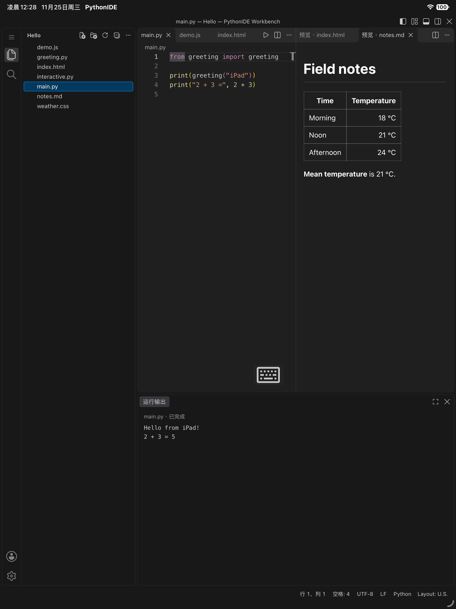
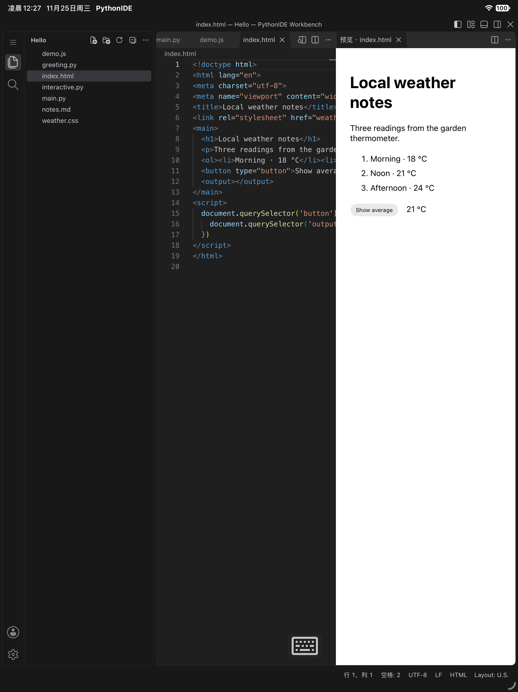
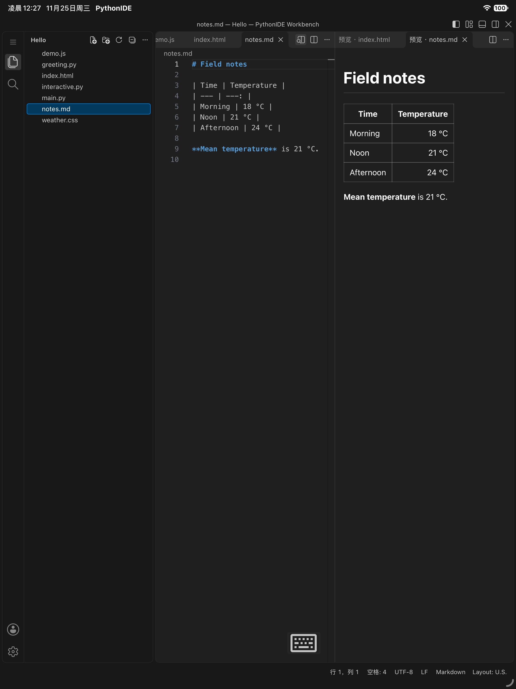

# PythonIDE iPad VSCode

English · [简体中文](README.zh-Hans.md)

An open-source Code-OSS workbench for PythonIDE on iPad. Run Python and JavaScript on your device, edit files side by side, and preview HTML and Markdown offline. Python uses the app’s interpreter and its existing Pro library entitlements. The workbench interface is available in English and Simplified Chinese.

**[Download PythonIDE on the App Store](https://apps.apple.com/app/id6753987304)** to run the workbench on your iPad.

<p>
  <a href="https://github.com/jinwandalaohu66/PythonIDE-iPad-VSCode/blob/v0.2.1/screenshots/ipad-python.png"></a>
</p>
<p>
  <a href="https://github.com/jinwandalaohu66/PythonIDE-iPad-VSCode/blob/v0.2.1/screenshots/ipad-html.png"></a>
  <a href="https://github.com/jinwandalaohu66/PythonIDE-iPad-VSCode/blob/v0.2.1/screenshots/ipad-markdown.png"></a>
</p>

*Python output, an HTML page and a Markdown table on the 13-inch iPad Air simulator. Select a screenshot for the full-size image.*

## Open on iPad

1. In a version of PythonIDE that includes the launcher, open the **iPad VSCode** folder at the top of the local workspace, open **`iPadVSCode.py`** in the regular script editor and tap **▶**. On the first run the launcher downloads the latest compatible release from GitHub, verifies its SHA-256 and opens the **Hello** project. You can inspect the [launcher source](https://github.com/jinwandalaohu66/PythonIDE-iPad-VSCode/blob/main/WorkbenchLauncher/iPadVSCode.py).
2. Select `main.py` in the workbench and tap **▶** in its editor tab. Read the result in **Run Output**. Try `demo.js` or select the preview icon in `index.html` or `notes.md`.
3. Run **the same launcher** to reopen your installed workbench offline. If the download was interrupted, run it again. To open your own project, place its folder beside `PythonIDEWorkbench` in the local workspace, reopen the workbench, then choose **File → Open Project Folder…**.

Choose **Help → Check for Workbench Updates…** or use the command palette. Confirm the update, then close and reopen the workbench. Ordinary launches work offline. Your projects, edited examples, layout and drafts stay in place. The updated launcher also offers an upgrade from 0.2.1. Run it with `--update` to check again. If your app still has the original launcher, save and run the current script from the launcher source link above.

**Manual installation** also works on versions with the required PythonIDE UI APIs. [Download the release ZIP](https://github.com/jinwandalaohu66/PythonIDE-iPad-VSCode/releases/latest/download/PythonIDEWorkbench.zip), unzip it in Files, and copy the entire `PythonIDEWorkbench` directory into PythonIDE’s local workspace. In the regular PythonIDE editor open its **top-level `main.py`** and tap **▶**. The separate `Projects/Hello/main.py` is the example you can run inside the workbench.

## Editing and running

| File | What you can do |
| --- | --- |
| Python | Run local scripts with project imports, text output and interactive input. Select a traceback location to open the source line. Use **Run with Arguments…** in the command palette to set arguments for one run. |
| JavaScript | Run ES modules in a Web Worker with relative project imports, console output and top-level `await`. Use an HTML page for browser code that needs the DOM. |
| HTML | Open a split preview with local stylesheets, images and page scripts. Save changes to refresh it. |
| Markdown | Preview headings, tables, code blocks and local images as you edit. |

Use **⌘S** to save, **⇧⌘P** to open the command palette, and **×** at the top right to close the workbench. A regular ▶ run uses no extra arguments. The JavaScript runtime provides Web APIs. The workbench currently has no Node.js runtime, desktop extension marketplace or breakpoint debugger.

## Files and recovery

Saving writes back to the original project. Switching projects or closing prompts for unsaved changes and active scripts. Open editors, split groups and cursor positions are remembered. Draft recovery writes to `.workbench-drafts/` inside the installed folder after a short idle period. A damaged draft is preserved while other drafts reopen. Recovery allows up to 4 MiB per draft and 24 MiB per project. Keep the installed folder when moving or backing up drafts. Files deleted in the workbench are moved into the project’s `.pythonide-trash/`.

Python scripts share the permissions of the host app. The workbench runs one foreground job at a time and keeps up to 65,536 characters of output. Stopping a native Python call may take until the call returns.

Use Explorer to create, rename, move and delete project files and folders. Files created by a running script appear automatically. Quick Open finds filenames, and Search finds text in files you have never opened.

## Development

The release includes the prebuilt interface. For a desktop preview with Python 3.11 or newer, run the following and open the local address printed in the terminal.

```sh
python3 main.py --preview --project /absolute/path/to/project
```

To rebuild the frontend, use Node.js 22.12 or newer.

```sh
cd client
npm ci
npm run build
```

Run `python3 -m unittest discover -s tests` for the local service. To publish, run `python3 tools/package.py ../PythonIDEWorkbench.zip --channel releases.json --min-host 1.8.5` from the repository root, using the minimum host version you verified. Attach the ZIP and `releases.json` to the same published GitHub Release before marking it Latest. The catalog retains earlier compatible releases.

The original PythonIDE workbench code is covered by the [MIT license](LICENSE). The editor uses [Code – OSS](https://github.com/microsoft/vscode) and the [Monaco VS Code API](https://github.com/CodinGame/monaco-vscode-api). Third-party license texts are in [licenses/](licenses/).
