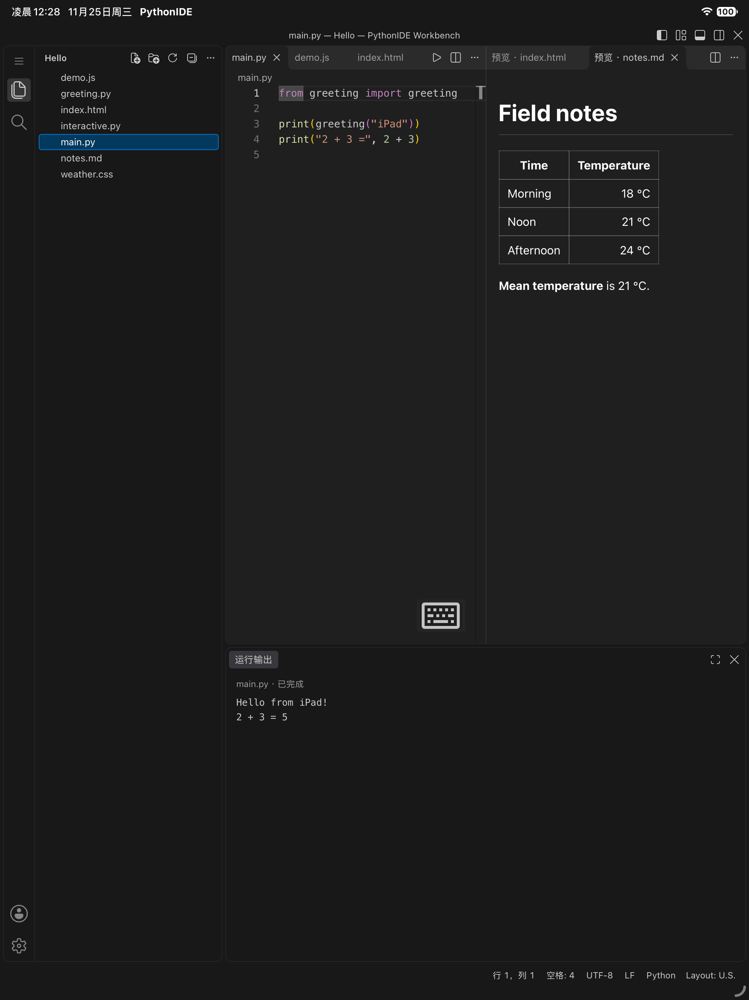
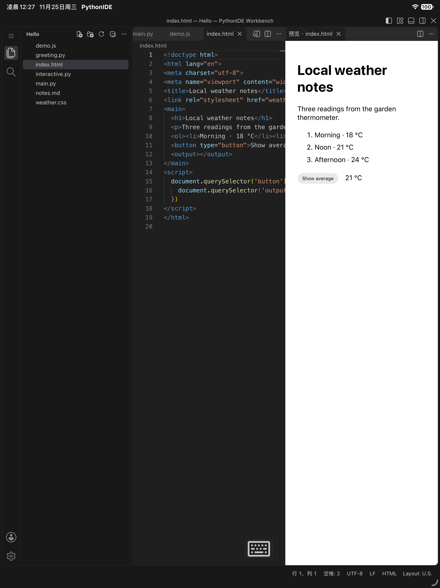
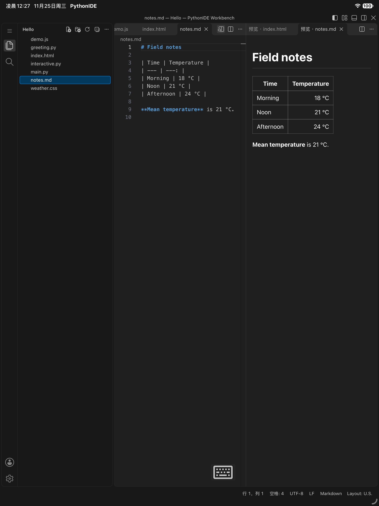

# PythonIDE iPad VSCode

[English](README.md) · 简体中文

在 iPad 上用熟悉的 Code-OSS 工作台编辑本地项目。你可以用 PythonIDE 的解释器运行 Python、在浏览器引擎中运行 JavaScript，也可以分栏预览 HTML 和 Markdown。工作台免费开源，Python 专业库沿用 PythonIDE 的会员规则。工作台界面支持英语和简体中文。

<p>
  <a href="https://github.com/jinwandalaohu66/PythonIDE-iPad-VSCode/blob/v0.2.1/screenshots/ipad-python.png"></a>
</p>
<p>
  <a href="https://github.com/jinwandalaohu66/PythonIDE-iPad-VSCode/blob/v0.2.1/screenshots/ipad-html.png"></a>
  <a href="https://github.com/jinwandalaohu66/PythonIDE-iPad-VSCode/blob/v0.2.1/screenshots/ipad-markdown.png"></a>
</p>

*13 英寸 iPad Air 模拟器上的 Python 输出、网页预览和 Markdown 表格。点图片可查看原图。*

## 在 iPad 上打开

1. 在提供启动脚本的 PythonIDE 版本中，从**本地工作区根目录**进入 **iPad VSCode** 文件夹，用普通编辑器打开 **`iPadVSCode.py`**，点 **▶**。首次运行从 GitHub 下载约 4.3 MiB，校验完成后自动打开 `Hello` 项目。[查看启动脚本](https://github.com/jinwandalaohu66/PythonIDE-iPad-VSCode/blob/v0.2.1/WorkbenchLauncher/iPadVSCode.py)
2. 在左侧打开 `main.py`，点编辑器标题栏的 **▶**，在下方查看输出。也可以运行 `demo.js`，或在 `index.html`、`notes.md` 中点预览图标。
3. 下次仍然运行 **`iPadVSCode.py`**，已安装的工作台可以离线打开。下载中断后，重新运行即可重试。

**手动安装**也可以使用支持相应工作台 API 的 PythonIDE 版本。[下载发行 ZIP](https://github.com/jinwandalaohu66/PythonIDE-iPad-VSCode/releases/download/v0.2.1/PythonIDEWorkbench.zip)，在「文件」中解压，把整个 `PythonIDEWorkbench` 文件夹放入 PythonIDE 的本地工作区。用普通编辑器打开**最外层的 `main.py`** 并点 ▶。包内的 `Projects/Hello/main.py` 是进入工作台后可以试跑的示例。

自己的项目可以放在 `Projects/` 下，也可以放在工作台文件夹旁。添加文件夹后重开工作台，在「文件」菜单选择「打开项目文件夹…」。文件保存、命令面板、编辑器分栏和面板布局均使用 Code‑OSS 的标准操作。外接键盘可用 ⌘S 保存、⇧⌘P 搜索命令。右上角 × 关闭整个工作台。

要给 Python 脚本传参数，打开项目中的 `.py` 文件，点左下角「管理」齿轮 →「命令面板…」，或按 ⇧⌘P。选择「带参数运行…」，输入参数并按回车。例如输入 `--title "iPad 周报" --width 800`，脚本的 `sys.argv[1:]` 就是 `["--title", "iPad 周报", "--width", "800"]`。参数只用于这一次。按 Esc 可取消，下次点 ▶ 会直接运行。

| 文件 | 操作 | 随包示例 |
| --- | --- | --- |
| Python · `.py` | 保存后在宿主现有 Python 环境运行，支持多文件导入、文本输出、`input()`、停止和错误定位 | `main.py`、`interactive.py` |
| JavaScript · `.js`、`.mjs` | 在独立 Web Worker 中运行 ES 模块，支持项目内相对导入、`console` 和顶层 `await` | `demo.js` |
| HTML · `.html`、`.htm` | 在独立的预览标签加载页面，支持项目内相对 CSS、图片和页面脚本。保存后刷新 | `index.html`、`weather.css` |
| Markdown · `.md`、`.markdown` | 在侧栏实时显示标题、表格、代码块和本地图片。编辑时自动更新预览 | `notes.md` |

JavaScript 脚本使用 Web API。需要 DOM 的代码从 HTML 页面启动。独立脚本的生命周期到模块求值完成，异步工作请使用 `await`。Node.js、npm 包安装、桌面扩展市场和断点调试均需另外集成。网页预览仅访问本项目资源，Markdown 采用静态渲染。其他文本文件可在编辑器中打开。

## 保存与恢复

保存会写回项目原文件。切换项目或退出时，工作台会询问是否保存改动。有脚本正在运行时还会询问是否停止。Python 在执行原生库调用时，停止可能要等该调用返回。请自行管理脚本创建的后台线程。

正常退出或切换项目时会记住各栏已打开的文件、当前标签及光标位置。回到同一个项目时会恢复这些编辑器，已移走的文件会跳过。

停笔约 350 毫秒后，工作台会把已修改的文件和未命名草稿分项目写入包内隐藏的 `.workbench-drafts/`。意外中断后，在同一位置再次运行工作台即可恢复最近成功写入的内容。每个未命名草稿单独恢复，并保留编辑语言。使用「保存」选择文件名后，内容才会写入项目。磁盘原件已变动的内容会在独立编辑页中恢复，可使用「另存为」。

如果某份草稿读不出，工作台会照常打开，列出未恢复的草稿，并在 `.workbench-drafts/` 中保留原件。其余草稿会继续恢复。后来编辑同一文件需要写入新的恢复副本时，损坏的原件会保存在同目录的 `.unreadable` 文件中。

保存或放弃一份草稿会清理它的正常恢复副本。单份草稿上限为 4 MiB，每个项目的可恢复草稿合计上限为 24 MiB。写入失败时仍可继续编辑、手动保存，或在切换项目和关闭工作台时选择「不保存」。移除工作台文件夹也会移除其中的恢复副本。

本地运行一次执行一个前台任务。输出保留最近 65,536 个字符。仅打开可信的 Python 脚本，它与 PythonIDE 共用解释器及宿主授予的权限。工作台文件浏览限制在选中的项目，浏览器预览与编辑器相互隔离。删除的项目文件可在项目的 `.pythonide-trash/` 中找到。

## 桌面预览与开发

需要 Python 3.11 或更新版本。将下面路径替换为自己的项目，访问终端打印的本机地址。

```sh
python3 main.py --preview --project /absolute/path/to/project
```

重建离线界面需要 Node.js 22.12 或更新版本。锁文件固定了编辑器、语言包和构建工具版本。

```sh
cd client
npm ci
npm run build
```

从包根目录运行 `python3 -m unittest discover -s tests` 可复查本地服务。运行 `python3 tools/package.py ../PythonIDEWorkbench.zip` 可从同一份源码和离线资源生成发行 ZIP。

`main.py` 和 `studio/` 提供启动、文件、运行与恢复服务，`client/` 包含工作台适配源码，`web/` 是可直接运行的构建结果。编辑器使用公共 Code‑OSS 和 CodinGame Monaco VS Code API，依赖清单及上游版权文本位于 `licenses/`。本项目自行编写的部分采用 MIT 许可，见 `LICENSE`。第三方组件分别适用原有许可证。

[公共编辑器上游](https://github.com/CodinGame/monaco-vscode-api) · [Code‑OSS 源码](https://github.com/microsoft/vscode)
